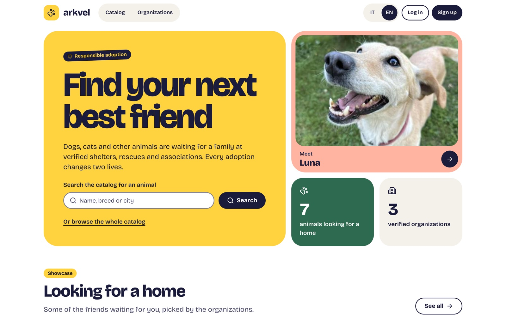
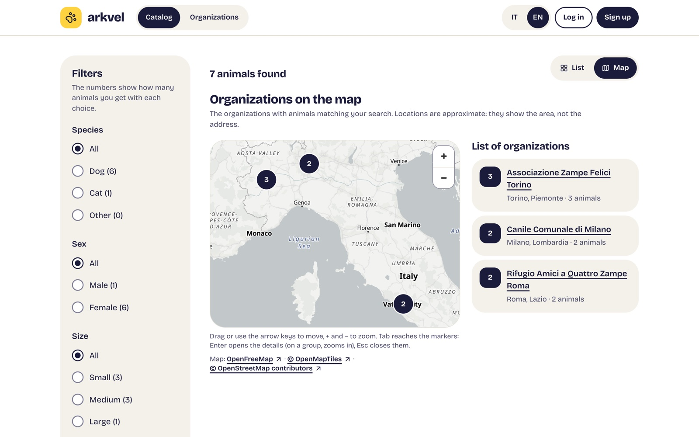
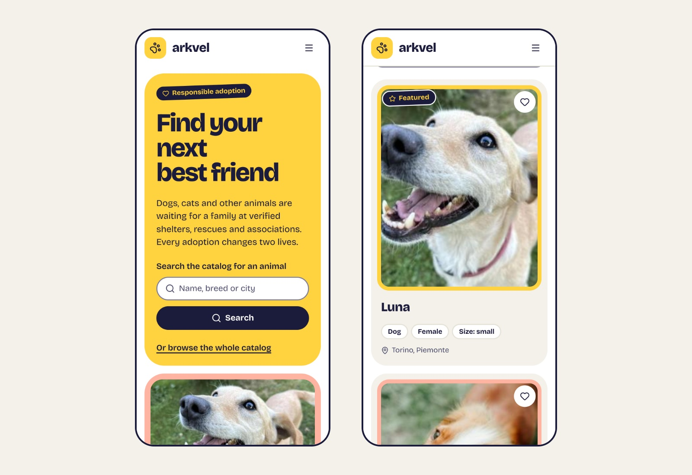
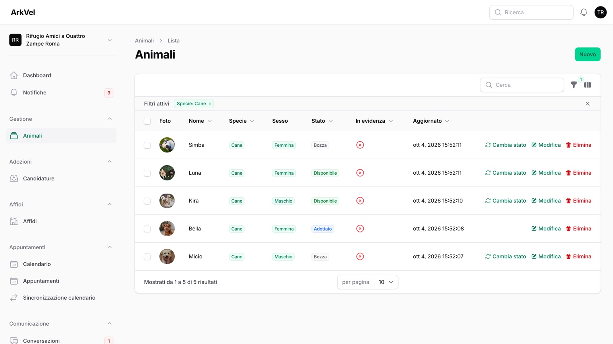

<h1 align="center">
  <picture>
    <source media="(prefers-color-scheme: dark)" srcset="docs/assets/logo-dark.svg">
    
  </picture>
</h1>

<p align="center">
  <strong>Open-source adoption & management platform for animal shelters, rescues and associations in Europe.</strong><br>
  A real tool for the whole journey — adoptions, fostering, appointments, medical care, messaging and donations — GDPR-first and self-hostable.
</p>

<p align="center">
  
  
  
  
  
</p>

---

## What is ArkVel?

Shelters, rescues and animal welfare associations too often run on spreadsheets, email threads and WhatsApp groups. **ArkVel** gives them a serious, modern platform instead — and keeps it **open source**, so the organisations that care for animals don't pay enterprise licence fees or hand their data to a closed vendor.

It's not just a listings site: it's an end-to-end system covering the **public adoption experience** and the **day-to-day operations** of an organisation, built as a multi-tenant platform where each organisation's data is isolated.

> **Status:** Beta. The public beta opens **22 November 2026** with the first pilot organisations. Built for an Italy-first pilot on a multi-country, multilingual architecture.

---

## Features

**Public site**
- Adoption catalogue with full-text search (Meilisearch), filters and a map of organisations
- Rich animal pages with image gallery; verified-organisation gating (no leaks of drafts)
- Organisation directory and public profiles; public adopter login & registration (Livewire)
- Privacy & terms pages, i18n (Italian base, English), accessibility to **WCAG 2.2 AA**

**Adopter portal** (`/account`)
- GDPR profile & questionnaire with recorded consents, favourites
- Adoption and fostering applications (with withdrawal), appointments, real-time messages
- Donations (one-off & recurring) with history, notification centre
- **Self-service account deletion** with anonymisation (GDPR right to erasure)

**Organisation management** (`/manage`, multi-tenant)
- Animals & medical records; adoption workflow as an explicit **state machine**, with PDF contract generation
- **Fostering** workflow and placements
- Appointments with a full in-app **calendar** (FullCalendar), drag-and-drop, and **bidirectional sync** with Google Calendar / CalDAV, plus a universal iCal feed
- Medical scheduling with automated reminders (scheduler + queue)
- Conversations with adopters, read-only donations ledger

**Platform admin** (`/admin`)
- Super-admin settings for Google Calendar and Stripe credentials — stored **encrypted** in the database, overriding `.env` at runtime

**Cross-cutting**
- Multi-tenant isolation, team-scoped roles & permissions
- **Real-time** messaging & notifications (self-hosted WebSockets, Laravel Reverb)
- Branded transactional emails, activity log, config-gated external integrations (Stripe, Google) — inert until configured
- **Dockerised** and **self-hostable** end to end

---

## Screenshots

<table>
  <tr>
    <td width="50%"></td>
    <td width="50%"></td>
  </tr>
  <tr>
    <td><b>Public site</b> — home with search and live counts</td>
    <td><b>Catalogue</b> — filters with counts and a map of organisations (approximate locations)</td>
  </tr>
  <tr>
    <td width="50%"></td>
    <td width="50%"></td>
  </tr>
  <tr>
    <td><b>Mobile</b> — the public site is designed mobile-first</td>
    <td><b>Organisation management</b> (<code>/manage</code>, Italian UI) — animals and their lifecycle state</td>
  </tr>
</table>

<sub>Demo data from the seeder.</sub>

---

## Tech stack

- **Laravel 13** · **PHP 8.4** · **Filament 5** (three panels: public adopter, shelter, admin)
- **PostgreSQL 16** · **Redis** · **Meilisearch** (search) · **Laravel Reverb** (WebSockets)
- **Tailwind CSS 4** · Livewire for the public site · **Docker** / Docker Compose
- **Spatie ecosystem**: permissions (teams), media library, translatable, activity log, model states, laravel-data
- **Laravel Cashier** (Stripe) for donations

Design: a **modular monolith** (`Enums`, `Models`, `States`, `Actions`, `Policies`, `Data`, `Support`, `Filament`, `Livewire`), SOLID, strict types, domain logic in invokable Actions, lifecycle via state machines, GDPR-by-design, tests in Pest (unit + feature + browser).

---

## Getting started (local)

Requirements: **Docker** and **Docker Compose**. Everything else runs in the containers (PHP 8.4, Composer, Node).

```bash
git clone https://github.com/SirAlyon/arkVel.git && cd arkVel

# Start the stack (php, nginx, postgres, redis, meilisearch, reverb, queue, scheduler, mailpit…)
docker compose up -d

# App setup (inside the php container)
docker compose exec php composer install
docker compose exec php cp .env.example .env
docker compose exec php php artisan key:generate
docker compose exec php php artisan migrate --seed   # demo data (never seeded in production)

# Front-end assets
docker compose exec php sh -lc "npm ci && npm run build"
```

- App: http://localhost:8090 · Mailpit: http://localhost:8025 · Meilisearch: http://localhost:7700
- Quality gate (must stay green): `docker compose exec php ./vendor/bin/pint` · `./vendor/bin/phpstan analyse` · `./vendor/bin/pest`

## Deployment

Production runs the same Docker stack with Caddy for automatic TLS. See **[docs/DEPLOY.md](docs/DEPLOY.md)** for the full runbook (server, DNS, env, Reverb behind TLS, Meilisearch, queues, backups) and **[docs/UI-RELEASE.md](docs/UI-RELEASE.md)** for the release checklist.

## Documentation

- [docs/DEVELOPMENT-PLAN.md](docs/DEVELOPMENT-PLAN.md) — roadmap & architecture
- [docs/CALENDAR.md](docs/CALENDAR.md) — calendar & external sync
- [docs/COMMUNICATION.md](docs/COMMUNICATION.md) — messaging, realtime & notifications
- [docs/DONATIONS.md](docs/DONATIONS.md) — donations (Stripe)
- [docs/WCAG-CHECKLIST.md](docs/WCAG-CHECKLIST.md) — accessibility

---

## Contributing

Contributions are welcome — see **[CONTRIBUTING.md](CONTRIBUTING.md)**. Every change ships with tests and a green quality gate (Pint + PHPStan level 6 + Pest).

## License

Released under the **GNU Affero General Public License v3.0 (AGPL-3.0)** — see [LICENSE](LICENSE). In short: free to use, study, modify and self-host; if you run a modified version as a network service, you must make your source available under the same terms.

## Credits

Created and maintained by **Alessio Sada** — [kiba.studio](https://kiba.studio). Inspired by [Baja Pet Rescue](https://github.com/kasugaijin/baja-pet-rescue), adapted to the European context (fostering, EU legal fields, microchip, EUR).
